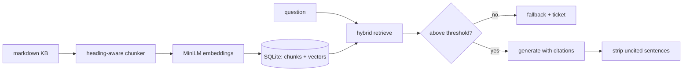

# rag-chatbot — a support chatbot that cites its sources or opens a ticket

[](https://github.com/darrshangovender/rag-chatbot/actions/workflows/tests.yml)
[](LICENSE)
[](https://python.org)
[](https://fastapi.tiangolo.com)

> Retrieval-augmented support Q&A over a markdown knowledge base. Heading-aware chunking, local MiniLM embeddings, hybrid dense + BM25 retrieval, and a generation path that strips any sentence without a citation before the answer leaves the process. Runs end to end on a laptop with no API key.

This is a **reference implementation** over a **synthetic** knowledge base (23 invented help-centre documents for a fictional product, "Cumulus"). It is not a client system and contains no client data.

## Why this exists

The failure mode that kills a support bot is not being wrong, it is being *confidently* wrong in a way the user can't check. So the citation is the load-bearing element: the model is instructed to attach a chunk marker to every claim, and a post-processor deletes anything unmarked. What the user sees is either grounded and linkable, or an honest handoff to a human.

## Quick start

```bash
make install            # pip install -e ".[dev]"
make seed               # index demo/sample_kb into data/index.sqlite
make run                # uvicorn on :8000
```

`make seed` downloads the `all-MiniLM-L6-v2` encoder (about 90 MB) on its first run; after that everything runs offline. No API key is needed: the default generator is extractive.

```bash
curl -s localhost:8000/ask -H 'content-type: application/json' \
     -d '{"question": "How do I revoke an API token?", "k": 5}'
```

Or drive the pieces directly:

```python
from api.ingest.loader import load_markdown_dir
from api.ingest.chunker import chunk_documents
from api.ingest.embedder import embed_texts
from api.store.sqlite_store import SqliteStore
from api.retrieve.hybrid import HybridRetriever
from api.generate.fallback import check_confidence

docs   = list(load_markdown_dir("./demo/sample_kb"))
chunks = chunk_documents(docs, max_tokens=350, overlap_tokens=60)
vectors = embed_texts([c.text for c in chunks], batch_size=32, normalize=True)

store = SqliteStore("./data/index.sqlite")
store.reset()
store.insert_chunks(chunks, vectors)

passages = HybridRetriever(store, alpha=0.6).search("How do I revoke an API token?", k=5)
print(check_confidence(passages).triggered)   # False
```

## How it works



1. **Load** every `*.md` under the source tree into `Document(source_path, title, text, last_modified)`.
2. **Chunk** on the markdown heading tree, carrying a breadcrumb section path; oversized sections split on blank lines with a 60-token overlap.
3. **Embed** with `all-MiniLM-L6-v2` locally: 384 dimensions, L2-normalised, no API call.
4. **Store** chunks and float32 vectors in SQLite.
5. **Retrieve** by blending cosine and BM25: `alpha * clip(cos, 0, 1) + (1 - alpha) * minmax(bm25)`, alpha 0.6.
6. **Gate** on the top score. Below the threshold (default 0.45), return a canned "I'm not confident" reply and append a ticket row.
7. **Generate** an answer whose every claim carries a `[n]` marker, then **strip** any sentence that doesn't have a valid one and map the surviving markers back to source paths.

| Module | Role |
|---|---|
| `ingest/loader.py` | Recursive `*.md` walk; title from the first H1, else the filename |
| `ingest/chunker.py` | markdown-it heading walk, breadcrumb sections, overlap-aware splitting |
| `ingest/embedder.py` | `all-MiniLM-L6-v2`, 384-d, lazy-loaded and cached |
| `store/sqlite_store.py` | `chunks` + `embeddings` (float32 BLOB) + `meta`; `load_all()` returns a numpy matrix |
| `retrieve/hybrid.py` | Dense cosine blended with min-max-normalised BM25 |
| `generate/citation_guard.py` | Citation contract in the system prompt + sentence-level uncited-claim stripper |
| `generate/fallback.py` | Confidence threshold; on trip, canned reply plus a JSONL ticket |

## Results

Produced by `make eval` (`eval/run_eval.py`) in the session this README was last updated, with the real MiniLM encoder on the bundled synthetic KB (23 documents, 127 chunks). The question sets are small and hand-written (in the script); treat these as a smoke measurement, not a benchmark.

| Measure | Value |
|---|---|
| Source hit@1 (22 in-scope questions) | 18 / 22 (82%) |
| Source hit@5 | 22 / 22 (100%) |
| Out-of-scope questions sent to a ticket at threshold 0.45 (8 questions) | 5 / 8 |
| In-scope questions wrongly sent to a ticket | 0 / 22 |
| Top-score range | in-scope 0.578 to 0.866; out-of-scope 0.118 to 0.496 |

"Hit" means the document that holds the answer is the top chunk's source (hit@1) or among the top five chunks' sources (hit@5). On this sample the two score ranges do not overlap, so a higher threshold (anything between 0.50 and 0.57) would have separated them; but that gap is visible only because the same questions were used to look for it, so the default stays at 0.45 and the gap should not be read as a result. There is no faithfulness or answer-quality metric here: nothing in this repository measures whether a generated answer is correct.

## Design decisions

| Decision | Why |
|---|---|
| **Local MiniLM rather than a hosted embedding API** | The repo runs without a key or a bill. Embedding quality is not the interesting part of this design; the guard is. |
| **Hybrid over pure dense** | Dense retrieval loses on rare literal strings (error codes, CLI flags), which support questions contain. BM25 covers them; dense covers paraphrase. |
| **Cosine clipped to [0, 1], not remapped with `(cos+1)/2`** | The remap hands every chunk a free 0.5 and, with min-max BM25 always giving the top lexical hit 1.0, made the confidence fallback unreachable. A regression test pins this. |
| **SQLite, not a vector database** | One file, no service to run. At this corpus size a numpy dot product over the whole matrix is fast. |
| **Strip uncited sentences rather than reject the whole answer** | Rejecting outright throws away good content over one stray sentence. |
| **Ticket on low confidence, not a guess** | A bot that says "I don't know, here's a ticket" is a working product. A bot that guesses is a liability with a chat interface. |

## Limitations

- **The fallback separates scopes only partly.** On the bundled eval, 3 of 8 out-of-scope questions still scored above the 0.45 default and got an answer. BM25 is min-max normalised per query, so the best lexical match always scores 1.0 even when it matches only stopwords ("what", "the"), which props up the score of irrelevant queries. Treat the threshold as something to tune on your own corpus.
- **Retrieval is imperfect.** 4 of 22 in-scope questions had the right document only at ranks 2 to 5 (for example a pricing question that ranked a rate-limit chunk first).
- **Default generation is extractive, not an LLM.** `LLM_PROVIDER` defaults to `extractive`, which returns the first two sentences of each of the top three passages, each tagged with its source. You get stitched snippets, not an answer. Set `LLM_PROVIDER=anthropic` with `ANTHROPIC_API_KEY` for model generation; that path is exercised in tests only through a stub, not against the live API.
- **A citation is checked for presence, not for support.** The guard verifies that a `[n]` marker exists and is in range, not that chunk *n* contains the claim. A model that cites confidently and wrongly passes.
- **The sentence splitter is heuristic.** It splits on `[.!?]` followed by whitespace and an uppercase letter or quote (after moving any `[n]` markers in front of the full stop). Sentences that start with a lowercase word, a digit or a bullet are not split, so one uncited clause can ride along on a cited one.
- **Every query is a full linear scan in process memory**, and the retriever is built once at startup. There is no ANN index and no reindex endpoint; re-ingesting needs a restart.
- **Markdown only.** No PDF, HTML or Notion loader.
- **No auth, rate limiting or tenancy.** `POST /ask` validates question length and `k` and nothing else.
- **Ticket writes are unlocked appends** to a JSONL file; under multiple workers lines can interleave.
- **Token budgeting is a whitespace-split approximation** (roughly within 30%), so 350-token chunks can overflow the encoder window on code-heavy or CJK content.

## Project layout

```
rag-chatbot/
├── api/
│   ├── main.py           # FastAPI: /health, /ask
│   ├── ingest/           # loader, chunker, embedder, CLI
│   ├── retrieve/         # hybrid dense + BM25 scorer
│   ├── generate/         # citation guard, confidence fallback
│   └── store/            # SQLite chunk + vector store
├── eval/run_eval.py      # retrieval + fallback eval on the synthetic KB
├── demo/sample_kb/       # 23 synthetic knowledge-base documents
├── tests/                # 144 tests, offline (stub encoder)
└── Makefile              # install, seed, run, eval, test, lint, clean
```

## Tests

```bash
make test        # 144 tests; the encoder is stubbed, so no model download and no network
make lint        # ruff
make eval        # needs the MiniLM encoder (downloaded by `make seed`)
```

The citation-guard and fallback suites are the substantial part: they pin what the stripper deletes, the out-of-range marker rule, the threshold boundary, and the regression for the cosine remap. CI runs lint, tests and the eval on Python 3.11 and 3.12.

## Author

Built by [Darrshan Govender](https://github.com/darrshangovender) · [Agulhas Code](https://agulhascode.co.za)
